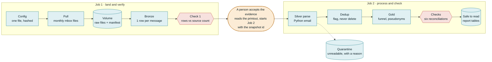

# The Recovering Data Scientist

**Workshop · Practical AI Thessaloniki**
Thu 12 Nov 2026, 19:00 to 21:00 · fromScratch HQ, Thessaloniki · in Greek

> The model was never the hard part. The systems, the data, and the people around it were.
> Joe Reis and Matt Housley, *Fundamentals of Data Engineering*

When I started thinking like a data engineer, I became a better data scientist.
**Be the bridge:** business question first, data engineering aligned to it, then the model.

**Talk @ Meetup.com:** https://www.meetup.com/practical-ai-thessaloniki-meetup-group/events/317253198/

## Chapters

0. **This page:** the idea, the bottlenecks and the evidence trail.
1. **[Setup](course/SETUP.md):** build and run both Jobs on Databricks Free Edition.
2. **Deep dives:** TBD.
3. **Worksheets:** TBD.

## What are the real bottlenecks?

| The story                               | Typical blocker                                          | The habit                                             |
| --------------------------------------- | -------------------------------------------------------- | ----------------------------------------------------- |
| The report nobody could trust           | Good numbers, but nobody could say which data made them  | An evidence trail from raw bytes to every number      |
| The pipeline that failed silently       | A source sent less data, and every job still ran green   | Checks that stop the run when counts don't add up     |
| The duplicate that inflated the numbers | Records arrived twice, and every count came out too high | A person defines "the same", the machine flags copies |

## The evidence trail

We start with the business question (Fictional): A consultancy must read the public discussion before advising a client, and cannot read everything.

It is your job as a data practitioner, to turn the above question into the below answer.

#### The data product

Two Jobs, six checks, one person in between. The data is public: one year of five Apache developer mailing lists, about 21,600 messages.

- **Teal:** the machine does it (provable).
- **Amber:** a person decides.
- **Red:** a check that can stop everything.

## Run it yourself, on any platform

- **Setup Guide** for Databricks Free Edition: **[course/SETUP.md](course/SETUP.md)**. Start here.
- **Deep Dives** Why these things matter? How do we arrive to this? Ownership? How to make these principles work in any platform using plain Python and SQL and much more!
- **Worksheets** Frameworks that will help you apply these principles your projects!

The setup guide is the high-level tour: it shows how much a platform does for you. The rest shows which parts were the platform and which parts were the habits.
