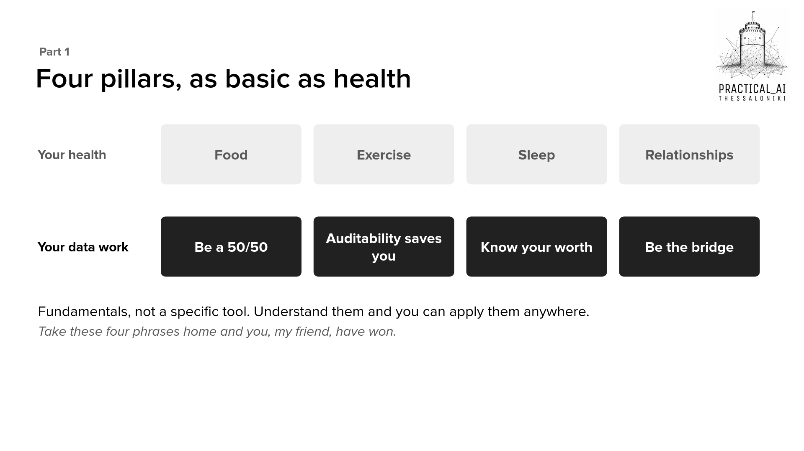

# 02 Claim It! DIY with Pure Python and SQL



**Level:** Intermediate (Python fluency is assumed) · **Duration:** about 45 min · **Builds on:** [01 End-to-end setup](01_SETUP.md)

## Short Overview

The talk was not about Databricks. The platform is popular because the principles above are built-in, but it did not invent them.

We rebuild the core of module 01 on your laptop with Python's standard library and SQLite: no cloud, no Spark, no orchestrator. You will see that the habits of module 01 came from you, not from the platform, and that you can take them to any job.

If you change jobs tomorrow and find a cron server and a shared drive, you can still build something with these best practices.

## What we will do - Long Overview

Let's quickly restate the principles of #01.

- **Be 50/50:** half software engineer, half data scientist
- **Auditability saves you:** every number can be traced back to the data that made it
- **Know your worth:** put a number on what you deliver, and on what it costs
- **Be the bridge:** stand between the business and the data, and own the decisions

Every platform feature you used in module 01 is a convenience over something you can do by hand. That is exactly what we do in this module.

### Requirements

- **Python 3.8 or newer.** Standard library only, nothing to `pip install`. Check with `python3 --version`.
- **git**, to clone the repo.
- **A terminal:** macOS and Linux have one. On Windows, see the note below.
- **One or more `.mbox` files.** Step 2 shows where to get them.

> **Windows users.** The commands in this module (`python3`, `curl`, `mkdir -p`, `echo $?`) are Unix ones and will not work in plain PowerShell or cmd. The simplest route is **WSL**: run `wsl --install` in PowerShell as administrator, restart, open the Ubuntu terminal, and do the whole module there. If you would rather stay in PowerShell, the script itself does run there: use `py` instead of `python3` and `echo $LASTEXITCODE` instead of `echo $?`.

### Learning outcomes

By the end of this module you will be able to:

- Explain which parts of module 01 came from the platform and which came from your own habits
- Keep raw files untouched in a snapshot folder, with a SHA-256 manifest and the config hash saved next to them
- Prove the split into messages lost nothing, by reassembling the rows and comparing hashes with the manifest
- Route every unreadable record to a quarantine table with a reason, so the counts still add up
- Flag duplicates in SQLite with a window function, without deleting anything

## Steps

All commands below run in the `course/` folder of the repo, next to the script. Step 1 takes you there.

### Step 1. Clone the repo and go to `course/`

```bash
git clone https://github.com/Practical-AI-Thessaloniki-Meetup/meetup-8.git
cd meetup-8/course
python3 --version
```

You should see Python 3.8 or newer. From here on you stay in `course/`.

### Step 2. Get one or more `.mbox` files

Create a folder called `inbox/` and put one or more `.mbox` files in it. Any mbox works.

- **The same data as module 01 (recommended).** The Apache mailing lists are public at [lists.apache.org](https://lists.apache.org/). You can browse a list there, for example [dev@iceberg.apache.org](https://lists.apache.org/list.html?dev@iceberg.apache.org).
- **Download data from the API.** To download one month as an mbox file, change the list and the month in this link: `https://lists.apache.org/api/mbox.lua?list=dev@iceberg.apache.org&date=2026-09`.

  From the terminal on Linux or macOS (or WSL):

  ```bash
  mkdir -p inbox
  curl -o inbox/iceberg_2026-09.mbox "https://lists.apache.org/api/mbox.lua?list=dev@iceberg.apache.org&date=2026-09"
  curl -o inbox/arrow_2026-09.mbox   "https://lists.apache.org/api/mbox.lua?list=dev@arrow.apache.org&date=2026-09"
  ```

  Two or three months are plenty. Be polite to the source: do not download hundreds of files in a loop.

  In Windows PowerShell, type `curl.exe` instead of `curl` (plain `curl` there is a different command). The rest of the line stays the same, and `mkdir inbox` replaces `mkdir -p inbox`.

Note: `.mbox` files are in the repo's `.gitignore`, so they cannot be committed by accident.

### Step 3. Create the config

Create `config.json` in `course/` with the only two settings the script needs: where to write snapshots, and the shortest body that gets a duplicate key.

```json
{"snapshots_dir": "snapshots", "min_body_chars": 50}
```

### Step 4. Run it

The script is [diy_pipeline.py](diy_pipeline.py): about 145 lines, standard library only. It does not download anything: it copies the files you put in `inbox/` into a new snapshot folder with a manifest, then runs Bronze, Silver, dedup and four checks in one go.

```bash
python3 diy_pipeline.py --config config.json --inbox inbox
echo "exit code: $?"
```

On a small synthetic test (two files, six messages, one HTML-only, three copies of the same text) it prints the following. Your snapshot id and counts will differ. The config hash will not, if your `config.json` is the same.

```
snapshot 20261118T101500123456Z | config b2b27db8e858 | files 2
bronze 6 | parsed 5 | quarantined 1 | duplicates 2 | unique 3
PASSED 1 bronze reassembles to every file hash
PASSED 2 parsed + quarantined = bronze
PASSED 3 primary + duplicates = parsed
PASSED 4 funnel never goes up
exit code: 0
```

Open the `snapshots/` folder: there is one folder per run, with the raw files, `manifest.json`, `params.json` and the SQLite database.

### Step 5. Go through the script as an observer

Open the script and find each habit. Each one is a few lines. As you find each habit, write it as a comment in the script, next to the lines that do it.

**1. Config is data, not code.** `load_config` refuses to start if a key is missing, then hashes a canonical form of the file (sorted keys, no whitespace), so the same settings always give the same hash.

**2. Land, then look.** `land` copies the files before anything reads them, writes `manifest.json` with a hash per file, and saves the config and its hash in `params.json` next to the data. Months later, the folder answers "which settings made this?" without anyone's memory.

**3. Bronze can prove the split lost nothing.** Check 1 joins every message of a file back together and compares the hash with the manifest. If the splitter had dropped a single byte, the hashes would differ.

**4. Every row ends up somewhere.** The parse loop never skips a bad row silently: its one `continue` comes only after the row is written to `quarantine`. A failure becomes a row in `quarantine` with a reason, which is what makes Check 2 possible.

**5. The key is a decision you can see.** The subject and body, `normalise` and `min_body_chars` are the whole definition of "the same message". Short bodies get no key, because "+1" and "thanks" are identical across unrelated mail.

**6. Failure is an exit code.** The script returns 1 if any check fails. That single number is what lets any scheduler, from cron to Airflow, stop the next step.

By now, you will have mapped out most of the code to the above basic habits! Well done!

And you must be thinking, well that is what these fancy Databricks features are doing. Exactly. So take a look at the table below that matches all of the good habits that are implemented in Databricks and how the DIY pipeline does the same.

#### Databricks and DIY Pipeline Mapping Table


| Habit                                   | On Databricks (module 01)                         | With no fancy tools                                                                            |
| --------------------------------------- | ------------------------------------------------- | ---------------------------------------------------------------------------------------------- |
| Pull from the source                    | `pull_notebook`, polite calls to the archive API  | By hand, in Step 2 (`curl` or a mail export). The script never downloads anything              |
| Settings in one validated, hashed place | `config/pipeline.json` + `00_setup_and_config`    | A small `config.json` of its own, read at the top of your script, required keys checked, hashed |
| Land raw evidence, untouched            | Unity Catalog volume, one folder per `snapshot_id` | A folder per run on disk: `snapshots/<timestamp>/raw/`                                          |
| Know what arrived                       | `manifest.json` with SHA-256 per file             | The same, written by `hashlib`                                                                  |
| One row per message, append-only        | Delta table `bronze_messages`                      | A SQLite table, written once per snapshot                                                      |
| Nothing disappears                      | `silver_quarantine` with reason codes             | A `quarantine` table with a reason column                                                       |
| Flag duplicates, do not delete          | `ROW_NUMBER()` in Spark SQL                       | `ROW_NUMBER()` in SQLite (it has window functions)                                             |
| Checks that stop the run                | `50_checks` raises, the Job turns red             | The script exits with code 1, so whatever runs it can stop (next module)                       |
| A person between landing and processing | Copying `snapshot_id` into Job 2                   | One script here; split it after the Bronze check to put a person in between                    |
| Run history                             | The Job's run page                                | The snapshot folders themselves, plus a `check_results` table in each                           |


Pretty cool, huh? Hopefully by now, you understand that you are not confined to the platform but you are inspired by it!

Take a look now at the toughest part of real Data Engineering, orchestration, when things come alive outside static notebooks. I always say that orchestration is where the business logic is exposed and that is why it is so hard to do it right. It's not Airflow, Dagster, Lakeflow but figuring out exactly what you need them to do. 

### Step 6. Notice what the script leaves out

The script is the core of Job 1 and Job 2 in one run, minus the pull (you downloaded the files yourself in Step 2) and minus Gold: it does not compute the KPIs, the review hours or the pseudonyms.

It stops at unique messages. It also leaves out the human gate between the two Jobs. In module 01, Job 1 stops after Bronze and Check 1 so a person can look before anything is derived. Here every check runs at the end, after the fact.

Putting the gate back is a matter of orchestration, and that is where a platform like Lakeflow Jobs makes life a lot easier. It is also the best way to see what the platform does for you. **That is the next module of the course:** a worksheet that takes the pipeline apart, then orchestrates it twice, once with bash and `cron` and once with Lakeflow Jobs, the way module 01 does.

I'll show you how I took the notebooks I had and reasoned about what would be the proper way to go about getting fresh data and processing that! 

### Step 7. Where the DIY version runs out

However, let's be honest about what the platform was buying us. You will feel these limits at scale and in production, not at 20,000 messages.


| You lose                                        | When it starts to hurt                              |
| ----------------------------------------------- | --------------------------------------------------- |
| Parallel compute                                | Millions of messages, or heavy parsing              |
| Access control and secrets management           | More than one person, or any personal data          |
| Run history, retries, repair of one failed task | More than a handful of steps, or nightly runs       |
| Lineage across tables                           | When someone asks "which report used this file?"    |
| Time travel on tables                           | When you need to see a table as it was last Tuesday |

So the ladder is: by hand, then a script, then a script with checks and exit codes, then an orchestrator, then a platform. Climb a rung when a limit actually hurts, not before. Each rung keeps the same habits.

### Step 8. Integration Exercise

Take one notebook or script from your own work and answer, in writing:

1. Where do its settings live? Could you print a hash of them?
2. Does it keep the raw input exactly as it arrived? Could you prove it?
3. If a row fails, where does it go? Can you count it?
4. Which count on one side of a step should equal a count on the other side?
5. Which step involves a judgement call? Is the decision written down anywhere?

Keep your answers. In the next module, the worksheet turns them into an orchestrated pipeline.

## Completion checklist

- [ ]  Cloned the repo and ran everything from `course/`
- [ ]  Downloaded at least one `.mbox` file into `inbox/`
- [ ]  Ran the script and saw four checks pass, with exit code 0
- [ ]  Opened a snapshot folder and found the raw files, `manifest.json` and `params.json`
- [ ]  Found each of the six habits in the script
- [ ]  Can say what the script leaves out compared to module 01: the pull, Gold and the human gate
- [ ]  Answered the five exercise questions for one of your own notebooks or scripts
- [ ]  Inspired by the habits behind the tools, not chasing the tools themselves.
