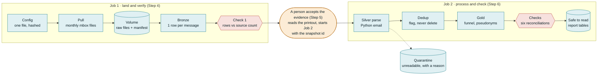

# 01 End-to-end setup

**Status:** Works end-to-end as of November 11th 2026. Typical issues are addressed in the troubleshooting section below. For issues not covered, open a GitHub issue. 

## Before you start: be the bridge

### Start with the business question

Everything here starts from a question someone in the business asked, not from the data or the tools.

**The question (fictional):** a consultancy is about to advise a client on adopting or upgrading a data-platform stack: Iceberg, Arrow, Kafka, Airflow, Flink. Before giving that advice, an engineer has to read what the developers of those projects discuss in public: breaking changes, deprecations, regressions. That is a year of five mailing lists, about 21,600 messages. Nobody can read all of it.

### Build a data product that answers it

You are the bridge between the person asking and the data. You answer them by building a **data product**: data turned into something a person can use to make a decision, that they can trust, and that someone owns.

### Turn the question into a KPI

A question is not yet something you can compute. To get there:

1. **Understand** what they actually need. Here: *what should the engineer read first, and what will it cost?*
2. **Formulate** it with the data you have. Here: unique messages, per list and per month, that mention the topics that matter.
3. **Clarify, or use a proxy** where you cannot measure the real thing. Nobody can measure "relevant" directly, so keywords (`breaking`, `deprecated`, `regression` and so on) stand in for it. Cost becomes review hours at an assumed reading rate.

So the KPI is: **which lists and months to read first, how many unique messages that is, and how many hours it costs.** Now we know what to build.

### Start with the end in mind

When you finish this guide you will have:

- The raw archive in your workspace, with a manifest of exactly what arrived and when
- One row per message, parsed. The messages that could not be read are set aside with a reason, not dropped
- Duplicates flagged, not deleted
- The answer, in tables you can query: a ranking of every list and month by priority (`gold_cell_summary`) and the headline numbers, such as review hours (`gold_kpis`)
- Six checks that all passed, so the answer is safe to read

You get there with two Jobs and one person in between: Job 1 lands the data and verifies it, you look at the result, and Job 2 processes it and checks it.



- **Teal:** the machine does it (provable).
- **Amber:** a person decides.
- **Red:** a check that can stop everything.

The full diagram, with every table and count, is in [architecture.md](../docs/workshop/architecture.md).

### How to read this guide

The goal is the big picture: what each stage does and why it is there. You do not need to read the notebooks line by line to follow along. Boxes marked **Observe** are the point of the course. Each one shows where a principle from the talk lives in the data product, and is tagged with it:

- **Be 50/50:** half software engineer, half data scientist
- **Auditability saves you:** every number can be traced back to the data that made it
- **Know your worth:** put a number on what you deliver, and on what it costs
- **Be the bridge:** stand between the business and the data, and own the decisions

Do not skip them to get to green faster.

**Running time:** a few minutes per Job (Job 2 took 4 min 33 s on the author's run). Building and reading take longer.

---

## Step 0. Accounts and the repo

1. Sign up for **Databricks Free Edition** with any email. Free Edition is serverless only, allows outbound internet to a list of trusted domains, and is for non-commercial use.
2. In the workspace tab, open **Workspace**, then **Create > Git folder**, and paste the repo URL: `https://github.com/Practical-AI-Thessaloniki-Meetup/meetup-8`. This clones the notebooks and the config into your workspace. If the repo is private, Databricks asks you to link a GitHub account first (Settings > Linked accounts).

> **Observe · Be 50/50.** The code and configuration are versioned on Git. This is the 101 course of recovering as a Data Scientist.

## Step 1. Read the config before running anything

Open `config/pipeline.json`. Everything that is a setting lives here, and nowhere else:

- `lists` and `window`: which mailing lists and which months to pull
- `source.pause_seconds`: how long to wait between calls (be polite to the source)
- `dedup.min_body_chars`: bodies shorter than this are never treated as duplicates
- `bronze.exceptions`: gaps a person has reviewed and accepted
- `gold.keywords`, `gold.scope_months`, `gold.review_rates_docs_per_hour`: the judgement calls behind the report

> **Observe · Be the bridge.** Look at the `gold` section. Keywords, scope months and review rates are not facts about the data. They are decisions, and they sit in config so anyone can see and change them.
>
> We want to use our data to drive decisions. But we cannot drive decisions we can trust if nobody can see the decisions that shaped the data.

## Step 2. Run `00_setup_and_config`

Open the notebook and run all cells. It validates the config, prints a SHA-256 hash of it, and creates the schema and the volume if they do not exist.

> **Observe · Be 50/50.** Note the config hash it prints. Now break the config on purpose: set `"pause_seconds": 0.1` and run again. The notebook stops with a message that names the exact setting, before any data moves. Put the value back.
>
> This is an API, not a static CSV. That means we need to version each snapshot, and that we need to be polite to it!
>
> Run the notebook a second time with no changes. Nothing breaks and nothing is duplicated. Every step in this project is safe to re-run (`IF NOT EXISTS`, files that exist are skipped).

## Step 3. Create the salt (one-off)

Gold replaces each claimed sender with a pseudonym: an HMAC-SHA256 of the address with a secret key (the salt). The salt never goes in the repo. You create it once, in a new notebook of its own:

1. In **Workspace**, open your home folder (not the Git folder), then **Create > Notebook**. Keeping it outside the Git folder means it can never be committed.
2. Paste the snippet below into the first cell and run it. It should print one line.
3. You can delete the notebook afterwards. The salt stays in the workspace's secret store.

```python
import secrets
from databricks.sdk import WorkspaceClient

w = WorkspaceClient()
w.secrets.create_scope(scope="email_forensics")
w.secrets.put_secret(scope="email_forensics", key="pseudonym_salt",
                     string_value=secrets.token_urlsafe(32))
print("Salt created (value not printed)")
```

The scope and key names must match `gold.salt_secret_scope` and `gold.salt_secret_key` in the config.

> **Observe · Be 50/50.** The config holds the *names* of the secret, never the value. Gold refuses to run if the salt is missing or shorter than 16 characters, and it reports only the error type.

## Step 4. Build Job 1: land and verify

In **Jobs & Pipelines**, choose **Create > Job**. A Job is a set of tasks that run in order. Add two tasks. For each one: set **Type** to Notebook, pick the notebook from your Git folder under **Path**, leave **Compute** on Serverless, and add any parameters under **Parameters**.


| Task name | Notebook        | Depends on | Parameters                                   |
| --------- | --------------- | ---------- | -------------------------------------------- |
| `pull`    | `pull_notebook` | none       | `snapshot_id` = empty (makes a new snapshot) |
| `bronze`  | `10_bronze`     | `pull`     | none                                         |

The task name must be exactly `pull`. The pull publishes the new `snapshot_id` as a task value, and Bronze reads it from the task with that name.

Click **Run now** (top right).

**Watching a run.** Open the Job's **Runs** tab and click the run. You see the tasks as boxes, coloured as they finish. Click a task to see its notebook output: everything it printed, cell by cell. This is where you read the printouts in the Observe boxes below.

> **Observe · Auditability saves you.** Open the volume and find your snapshot folder. A **volume** is a folder for files (not tables) that lives inside the catalog, next to your tables, so the raw files sit under the same name and the same permissions as the data made from them. To get there: in the left sidebar open **Catalog**, then `workspace` > `email_forensics` > **Volumes** > `raw`, and open the folder named after your `snapshot_id`. You will see:
>
> - `pull_params.json`: what was asked for, including the full config and its hash
> - `manifest.json`: what actually landed, one row per file with its SHA-256
> - `stats/`: what the source *says* it has, per month
> - `mbox/`: the raw files, untouched
>
> "What arrived" is now a fact on disk, not a memory. Auditable. This prevents unnecessary war stories.

> **Observe · Auditability saves you.** Read the Bronze printout. Three independent counts are compared for every file: the source's own count, the number of `From ` separator lines in the file, and the rows Bronze wrote. Check 1 passes only if no file has fewer rows than the source says it should.

Copy the `snapshot_id` from the printout. Your counts will differ from the author's (about 21,600 messages across 60 files), because the archive keeps changing. That is exactly why every run is tied to a `snapshot_id`.

### If Check 1 fails

This happened on my first snapshot: One file was 2 messages short of the source count, cause unknown. The fix is **not** to re-pull until it goes green. A person looks at the gap, decides whether it is acceptable, and records the decision in config:

```json
"bronze": {
  "exceptions": [
    {"file": "<file name>", "accepted_shortfall": 2, "reason": "<what you found and why you accept it>"}
  ]
}
```

Commit it, pull the change into your Git folder, and **repair** the run so only `bronze` re-runs.

> **Observe · Be the bridge.** The machine found the gap. Only a person can decide whether it matters. The decision is named, bounded (2, not "some") and in git, and Bronze prints it on every run.

## Step 5. The human gate

Job 1 does not start Job 2. You do. Job 1 green means a person has accepted the evidence. Copying the `snapshot_id` by hand is the gate.

> **Observe · Be the bridge.** A Job can only pass or fail. Somebody has to decide where a person must look before the next step starts. This project puts that person between landing the evidence and deriving anything from it.

## Step 6. Build Job 2: process and check

Create a second Job the same way, this time with a **Job parameter**.

1. **Add the Job parameter.** A Job parameter belongs to the whole Job, not to one task. In the panel on the right of the Job page, find **Job parameters** and add one with the key `snapshot_id`. Leave its default value **empty**.
2. **Add the four tasks.** Each one passes the Job parameter on with the value `{{job.parameters.snapshot_id}}`:


| Task name | Notebook    | Depends on | Parameters                         |
| --------- | ----------- | ---------- | ---------------------------------- |
| `silver`  | `20_silver` | none       | `snapshot_id`, `dry_run` = `false` |
| `dedup`   | `30_dedup`  | `silver`   | `snapshot_id`                      |
| `gold`    | `40_gold`   | `dedup`    | `snapshot_id`                      |
| `checks`  | `50_checks` | `gold`     | `snapshot_id`                      |

3. **Run it with your snapshot.** Open the arrow next to **Run now** and choose **Run now with different settings**. Paste the `snapshot_id` you copied into the `snapshot_id` box and click **Run**.

The default stays empty on purpose. You give the snapshot each time you run, so a run is never on a snapshot you did not choose.

> **Observe · Auditability saves you.** In the `silver` output, find the quarantine counts. On the author's snapshot, 30 of 21,634 messages could not be parsed, mostly HTML-only messages with no readable text. They were not dropped: they sit in `silver_quarantine` with a reason code (`no_text_plain`, `empty_text_plain` or `parse_error`), and parsed + quarantined = Bronze (Check 2).

> **Observe · Auditability saves you.** In the `dedup` output, see how many rows were flagged as duplicates (65 on the author's snapshot). They were flagged, not deleted. Every copy and every location is still there, so the definition of "duplicate" can change later without losing anything.

> **Observe · Auditability saves you.** Query the results of the last task. In the left sidebar open **SQL Editor**, then **Create new query**. In the compute dropdown at the top, pick **Serverless Starter Warehouse**. Paste the query, put in your `snapshot_id`, and click **Run**:
>
> ```sql
> SELECT check_name, passed, detail
> FROM workspace.email_forensics.check_results
> WHERE snapshot_id = '<your snapshot_id>'
> ORDER BY check_name;
> ```
>
> Six rows, six passes. Only now is Gold safe to read.

> **Observe · Know your worth.** Now read the answer to the business question. In the same SQL Editor:
>
> ```sql
> SELECT metric, value, rate, note
> FROM workspace.email_forensics.gold_kpis
> WHERE snapshot_id = '<your snapshot_id>'
> ORDER BY metric;
> ```
>
> `review_set_size` is how many messages the engineer has to read, and `review_hours` is what that costs at 50 and at 100 messages an hour. `hours_avoided_by_dedup` is the time saved by not reading the same message twice. `estimated_cost` is empty on purpose: only the business can tell you what an hour of an engineer costs. Every row carries a note, and the review rates say "assumed rate, not a benchmark".
>
> Putting a number on the "so what" is how you show your worth. Labelling which parts are assumptions is how that number stays honest. For which lists and months to read first, query `gold_cell_summary` ordered by `priority_rank`.

## Step 7. Make it fail on purpose

Run Job 2 again, this time with `snapshot_id` **empty**: choose **Run now with different settings** as in Step 6, clear the `snapshot_id` box, and click **Run**. The `silver` task stops at once with "snapshot_id is empty inside a Job", and nothing after it runs.

> **Observe · Auditability saves you.** A pipeline that guesses ("use the newest snapshot") would have gone green on the wrong data. This one refuses to guess inside a Job. Failing loudly and early is a feature.

## Step 8 (optional). Compare the two ideas of "the same message"

Job 2 decided that two messages are the same when their subject and body match (a content hash). Most people would reach for a different key: every email carries a Message-ID header that is supposed to be unique. This step checks whether the two definitions agree on this data.

Open `31_dedup_compare` from your Git folder and click **Run all**. It is not part of either Job, and it does not change any existing table. It reads the Silver tables for one snapshot, puts both definitions side by side, and writes one small report table, `silver_dedup_compare`, one row per metric. After the first run a `snapshot_id` box appears at the top of the notebook: leave it empty to use your newest snapshot, or paste a `snapshot_id` and run again.

> **Observe · Be 50/50.** On the author's snapshot the two disagree. 25 copies are caught by both, 40 only by content, 3 only by Message-ID, and in a few cases the same Message-ID joins different text. A key everyone trusts is wrong some of the time. Both rates are reported side by side and never mixed.

## What you built

```
config -> pull -> volume (raw files, manifest) -> Bronze (Check 1)
        -> a person accepts the evidence
        -> Silver parse (+ quarantine) -> Dedup -> Gold -> Checks (six)
```

See [architecture.md](../docs/workshop/architecture.md) for the full diagram.

## Troubleshooting


| You see                                                      | Likely cause                                            |
| ------------------------------------------------------------ | ------------------------------------------------------- |
| `config: '...'` error in setup                               | A setting failed validation. The message names it       |
| Bronze: "No snapshot_id ... Check the task is named pull"    | The first task of Job 1 has a different name            |
| Silver: "dry_run is true inside a Job"                       | Set the `dry_run` task parameter to `false`             |
| Silver: "snapshot_id is empty inside a Job"                  | Run with **Run now with different settings** and paste the `snapshot_id` (Step 6) |
| Gold: "Could not read the salt secret"                       | Step 3 not done, or names differ from the config        |
| `pull` fails on the config hash when pinning an old snapshot | Intended: a snapshot is tied to the config that made it |

## Next steps

You have run the pipeline on a platform that did a lot of work for you. The deep dives (coming after the talk) look at which parts were the platform and which parts were the habits.
