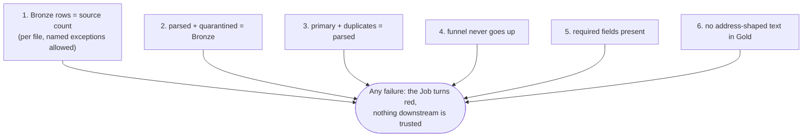
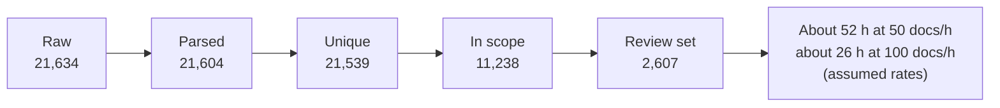

# Architecture: email forensics, end to end

One page that shows how the pieces fit. The diagrams are Mermaid, so they render on GitHub and in most Markdown viewers.
Counts are from snapshot `20261101T210751Z` unless marked otherwise.

## 1. The whole flow

```mermaid
flowchart LR
    subgraph CFG["Config (one place)"]
        C["config/pipeline.json<br/>lists, window, keywords,<br/>dedup rule, exceptions"]
        S00["00_setup_and_config<br/>validate, SHA-256 of config,<br/>create schema + volume"]
        C --> S00
    end

    subgraph J1["Job 1: land and verify"]
        P["pull<br/>pull_notebook<br/>one mbox per list and month"]
        V[("Volume /snapshot_id/<br/>mbox files, stats,<br/>manifest.json,<br/>pull_params.json")]
        B["bronze<br/>10_bronze<br/>split on 'From ', hash"]
        BT[("bronze_messages<br/>21,634 rows<br/>raw bytes + SHA-256")]
        K1{{"Check 1<br/>rows vs source count<br/>(exceptions in config)"}}
        P --> V --> B --> BT --> K1
    end

    H(["A person reads the Bronze printout,<br/>accepts the evidence,<br/>copies snapshot_id"])

    subgraph J2["Job 2: process and check"]
        SV["silver<br/>20_silver<br/>parse with Python email"]
        SM[("silver_messages<br/>21,604")]
        Q[("silver_quarantine<br/>30, with reason codes")]
        D["dedup<br/>30_dedup<br/>content hash, ROW_NUMBER"]
        DT[("silver_dedup<br/>21,539 primary<br/>65 flagged duplicates")]
        G["gold<br/>40_gold<br/>funnel, review set,<br/>HMAC pseudonyms"]
        GT[("6 gold_* tables<br/>no subject, body<br/>or address")]
        CK{{"checks<br/>50_checks<br/>six reconciliations"}}
        SV --> SM & Q
        SM --> D --> DT --> G --> GT --> CK
    end

    OUT["Gold is safe to read<br/>(dashboard later)"]
    X["31_dedup_compare<br/>Message-ID vs content hash<br/>report only, run by hand"]

    S00 -. "%run" .-> P & B & SV & D & G & CK
    K1 -->|green| H --> SV
    CK -->|all six pass| OUT
    DT -.-> X
```

## 2. The six checks, and where each one bites

| Check | Question it answers | What it does not prove |
|---|---|---|
| 1 | Did every message that the source says exists land? | That the source itself was complete |
| 2 | Did any message vanish while parsing? | That the parsed rows are the right rows (counts only) |
| 3 | Did dedup lose or invent rows? | That two copies differing only in invisible characters were caught |
| 4 | Does each funnel step only remove? | That a wrong join that also shrinks the numbers is wrong |
| 5 | Are the fields the review needs present? | That the values are true (sender is claimed, not verified) |
| 6 | Did any address-shaped text reach Gold? | That nothing personal reached Gold (names are out of scope, ADR 0011) |

## 3. The funnel (what Gold reports)

The in-scope step comes from the window and list choices in config, so it is a decision, not a fact about the data.

## 4. Where a person decides and where the machine enforces

| Step | Machine | Person |
|---|---|---|
| Config | Validates and hashes it | Chooses lists, window, keywords |
| Pull | Downloads, writes the manifest | Starts the run |
| Bronze | Splits, hashes, runs Check 1 | Accepts a gap and records it as a named exception |
| Between the Jobs | Nothing | Copies `snapshot_id` into Job 2 (the human gate) |
| Silver | Parses, quarantines with a reason | Decides that a bad date is a flag, not a failure |
| Dedup | Hashes and flags | Decides what "the same message" means |
| Gold | Counts, ranks, pseudonymises | Sets review rates and scope, reads the result as a proxy |
| Checks | Fails the Job | Decides which checks stop the run |

## 5. Facts about the tables

| Table | Grain (one row is) | Written by | Rerun behaviour |
|---|---|---|---|
| `bronze_messages` | one message occurrence in one file | `10_bronze` | append-only; skips files already loaded for the snapshot |
| `silver_messages` | one parsed message occurrence | `20_silver` | replaces only this snapshot (`replaceWhere`) |
| `silver_quarantine` | one message that could not be parsed | `20_silver` | replaces only this snapshot |
| `silver_dedup` | one parsed row with its `dup_key` and flag | `30_dedup` | replaces only this snapshot |
| `gold_*` (6) | funnel step, review message, list-month cell, list, curve step, KPI | `40_gold` | replaces only this snapshot, table by table |
| `check_results` | one check result | `50_checks` | replaces only this snapshot |
